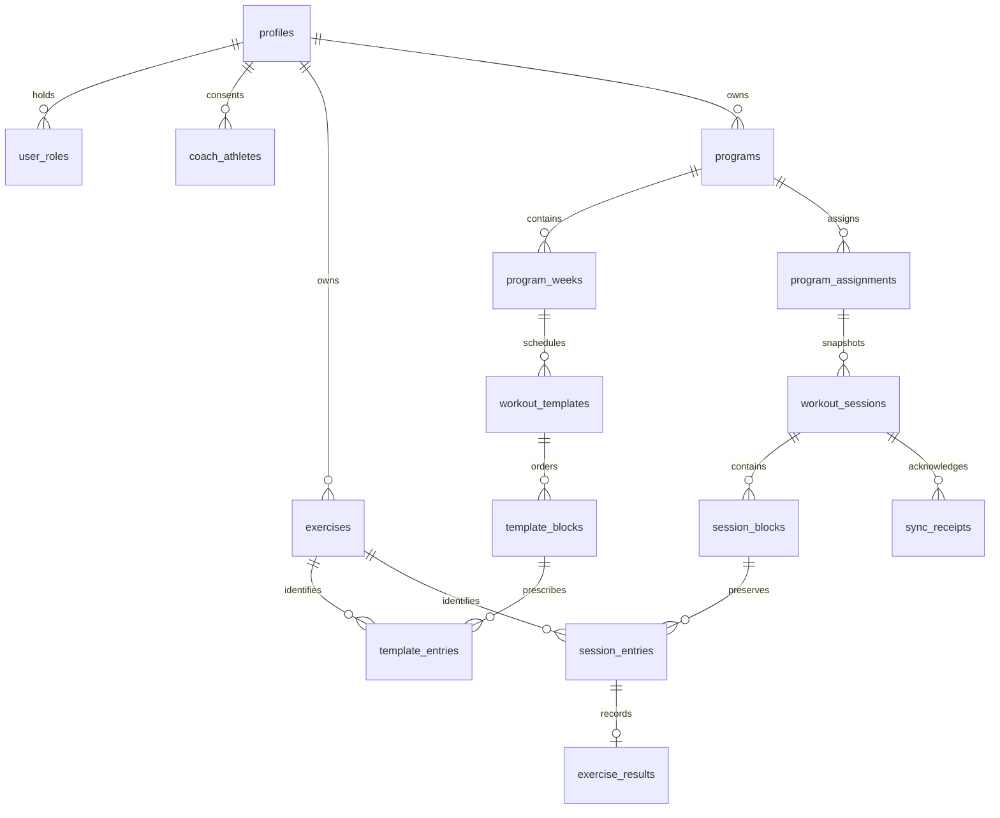

# Architecture and decisions

The three files in `docs/product` are the authoritative product knowledge. Technical choices below fill their unspecified details.

## Application

Next.js App Router, React, strict TypeScript, Tailwind v4 with semantic CSS tokens, Lucide icons, Supabase JS with schema-derived TypeScript types and runtime-validated session responses, TanStack Query for coach reads, and Dexie for durable athlete data. No service-role key, custom production backend, generated sample training, or remote font dependency. The public Next.js shell is intentionally cacheable and contains no personal data. Hash navigation keeps every operational screen on the same offline-capable document. `/api/me` demonstrates server-validated bearer authentication; protected business operations go directly to Supabase with the same user's JWT and are checked there.

Authentication is client-side email/password, including email-confirmation callbacks to the origin. Supabase persists/refreshes tokens. Server-rendered authenticated content/cookie middleware is deliberately unnecessary for this offline shell: local cached identity gates the UI, while actual authority always comes from RLS/RPC checks. A previously authenticated account can access cached workouts on its device without contacting the server. This is a device cache, not proof of current server authorization. A revoked/expired token cannot synchronize. Reauthentication keeps local edits; a different account cannot take over another account's outbox.

No data exists until a coach creates/imports a program and assigns it. Empty states are intentional.

## Relational database

Apply every SQL file in `supabase/migrations` in filename order. The initial schema and additive refinements apply transactionally. Migration history, rather than rerunning CREATE statements, supplies repeatability. Use a dedicated project; never reset production.

Ownership, exercise identity, assignment, schedule, blocks, entries and results are relational. JSONB is reserved for flexible prescriptions, extensible result metrics, and RPC transport. Import JSON is decomposed transactionally; it is not a blob database.

- Signup trigger creates profile + athlete capability. Coach capability is granted by a trusted administrator in SQL, never from signup metadata.
- Coach-athlete access requires an athlete-accepted relationship. An account can coach itself without a relationship row.
- Program weeks have 1–52 numbered weeks. Day 1 is the assignment start date; day 2 is the next date, rather than an implicit weekday. Duplicate-day workouts are allowed and ordered.
- Workout templates are reusable through program duplication and builder copy controls. Program edits create a new version of the reusable definitions. Assignments record the version used.
- Assignment copies ordered blocks, labels, prescription, exercise display name, instructions, eligibility, and reference URL into session tables. Exercise ID stays stable. Changing templates/library records never updates snapshots or results.
- Deleting/replacing templates nulls the optional source template link; history remains. The owner-coach-only `remove_program` RPC deletes the program, its templates and every assignment atomically. Sessions detach from deleted assignments. Unstarted, never-synced workouts dated today or later in each athlete's timezone are withdrawn from the schedule; past and recorded workouts remain. Withdrawn snapshots stay in the database so queued offline edits still synchronize with their original IDs, versions and receipts. A later logged edit makes that snapshot visible again as an independent workout. Reconciliation removes withdrawn workouts from device caches only when no local work is pending. Workout snapshots/results have no direct browser delete grants. Athletes can clear an individual recorded result through the normal versioned full-log mutation; this deletes the result row without deleting its prescribed session entry, exercise definition, or template. Session finalization remains independent of the reduced completion count. Account deletion/anonymization is an explicit future administrative workflow, not a cascading loss of history.
- Stable exercise keys are unique per coach. Imports reuse that coach's existing canonical movement; existing library name/video wins. Keys should be deliberately reused; aliases do not perform fuzzy identity matching. Update the library before assigning if a reference/name needs changing.
- Browser exercise updates are limited to name, aliases and reference URL. UUID, owner and stable key cannot be updated through the API, even if a client bypasses the read-only form.
- Optional workout description, category and estimated minutes live on both templates and session snapshots. Existing sessions gain empty details through the additive migration; they are never backfilled from a template that may already have changed. Editing template details affects new assignments only.
- RLS is enabled on every application table. Read access follows ownership and accepted relationships. No browser may write roles, assignments, snapshot structure, results, or receipts directly. Definer RPCs have fixed search paths, explicit caller checks, atomic writes, and restricted execution grants. Client Zod validation is supplemented by server validation.
- An additive migration wraps request-constant identity/capability lookups in scalar subqueries so Postgres can initialize them once per statement. Ownership predicates and grants are unchanged; local advisors report no warnings after the migration.
- Foreign keys, natural uniqueness, UUIDs, status constraints and useful ownership/ordering indexes enforce integrity. Results have at most one row per session entry. Empty, unchecked slots are omitted from storage; history requires eligible completion or non-whitespace actual load/notes. Opening workouts, references and history is read-only. The history dialog includes the current result for management; last-used summaries use earlier sessions only. Receipts have one row per logical mutation.

## Workout and metric invariants

`finished` and `finished_at` finalize a session independently of eligible completion. The database requires a finished timestamp exactly when status is finished. Reopening clears the timestamp and retains results. Finished sessions require explicit reopening before UI edits. Instruction blocks cannot include eligible entries; other reference/rest entries can set `eligible:false`. Sessions without eligible entries are rest/instruction sessions and are excluded from adherence.

Completion aggregates **completed eligible entries / eligible entries** in the chosen schedule range, including local pending edits. Never average percentages. Calendar day/week/month summaries aggregate every workout in the displayed range. Dashboard week/month exercise completion includes that entire scheduled range; overall includes sessions through today. Adherence is **finished due eligible sessions / due eligible sessions**, where due means the athlete-local schedule date is today or earlier. Skipped, missed, and in-progress sessions remain in the due denominator. Future sessions are scheduled, never missed. An empty denominator displays N/A. Finished incomplete sessions display partial completion without changing their status.

Coach athlete reviews use each athlete's profile timezone, independently of the coach's timezone. Dates are ISO date-only values. Calendar math uses UTC noon to avoid DST shifts; determining today uses the profile's IANA timezone. Results/finalization use UTC timestamps. Same-day multiple sessions are independent. The server log timestamp is the athlete's supplied finish time; receipt timestamps record server acknowledgement.

## Offline persistence and synchronization

IndexedDB stores `sessions`, one cached `identity`, and an `outbox`. Workout writes use one read/write transaction across session and outbox tables. Each mutation receives a client UUID, owner, session, expected base version, complete small result log, timestamp and attempt/error fields. Every local edit increments the local session version. Inputs write on change, including before blur. TanStack Query is not the persistence layer.

Foreground sync runs on open, reconnect, visibility return, a short delay after edits, and every 30 seconds while mounted. Supabase requests abort after 15 seconds so a stalled request cannot permanently hold the sync loop. Retries retain the original UUID. A single foreground loop runs per account in a tab; duplicate sends from multiple tabs are safe at the database. Session rows are locked during server mutation; an existing receipt returns its original acknowledgement. Expected-version mismatch creates an explicit conflict. Each transaction validates every result belongs to that session and that instruction entries are not marked completed. Results + finalization + version increment + receipt commit together. A lost network acknowledgement can be retried without a second write. The client deletes only acknowledgements matching the expected next version; malformed acknowledgements retain the mutation for retry. Failed remote reads show Sync needs attention even with an empty outbox. Individual mutation errors are visible in Profile, and successful synchronization does not dismiss unrelated application errors.

Pending operations are ordered by session and base version. An error blocks later operations for that session while allowing unrelated sessions to sync. Remote reads never overwrite a session with pending local edits or regress a newer version. Online reconciliation removes inaccessible cached sessions when no local edits are pending. A removed relationship cannot immediately erase an offline device's existing cache; reconnect or logout is required.

Conflicts retain the local session, failed mutation and remote version. Profile shows a comparison of results and finalization. The user explicitly chooses to rebase their complete local log onto the current server version or replace local data with the server version. Export is available before either choice. No automatic last-write-wins. If the local version changes after comparison opens, both choices are rejected and require a fresh review, preserving the new edits. A second server conflict requires review again. Complete-log conflict resolution deliberately trades granular merging for predictable, reviewable choices.

Logout refuses to silently delete pending work. Synchronize first, or export and explicitly confirm discard. Explicit discard checks the reviewed mutation IDs inside the clearing transaction and refuses if new or another account’s work appeared. Device logout verifies that SDK credentials are removed even if the server revocation request fails offline; this does not claim server-side token revocation. See [Supabase sign-out semantics](https://supabase.com/docs/reference/javascript/auth-signout). Successful logout atomically refuses any newly queued edits and clears personal IndexedDB and query caches. In-flight remote pulls cannot repopulate the cache after logout. Public shell caches contain no private responses. IndexedDB/auth storage is device-local browser storage, not separately encrypted; use a trusted device and sign out on shared devices. Browser/OS eviction or manually clearing storage can remove unsynced data; export pending logs when needed. The browser requests persistent storage when supported to reduce eviction risk. No application can guarantee persistence after OS storage deletion.

## PWA and presentation

Manifest, approved-master PNG icons, Apple metadata, viewport safe areas and standalone display are supplied. Each production build generates a release ID used in the worker registration URL and cache name. The worker precaches the public document with its initial Next scripts/styles, then caches same-origin static assets. Supabase/auth/API/RSC responses are never service-worker cached. Navigation falls back after an outage or a five-second network stall; Dexie restores the actual view. Network HTML never overwrites the paired fallback document. Failed precaching prevents installation; a waiting worker activates only after old clients close. Activation cleans old shell caches without touching IndexedDB. External videos require connectivity. Development deliberately does not install a service worker.

The Acid Green / Carbon visual system and approved raster icon integration are documented in [interface conventions](DESIGN_SYSTEM.md). Light/dark colors use shared tokens; system preference is the default and explicit selection persists locally. Touch targets, native labels, keyboard focus, semantic checkbox buttons, dialog focus trapping, reduced-motion rules and responsive navigation support gym use.

## Deliberate limits

No production credentials/accounts/deployment were used. Embedded PostgreSQL tests use an `auth.uid()` shim and browser test Auth endpoints are simulations. A separate loopback-only integration script verifies real local GoTrue/PostgREST with temporary accounts. Hosted confirmation mail, actual iOS installation/force-close/storage eviction and Vercel still require operator checks. Coach editing is online; offline support prioritizes synchronized athlete workouts. The session RPC returns the accessible snapshot history in one call; large multi-athlete histories need representative latency/payload measurement before broader rollout. Detailed sets, timers, nutrition, chat, payments and in-app AI generation remain outside MVP.

## Personal feedback backlog

Profile contains an owner-private personal backlog (title, optional description, creation date, Open/Implemented). This explicitly requested utility adds no coaching messages, voting or project workflow. IndexedDB v2 adds feedback and a durable feedback outbox without modifying existing workout stores. Saves and outbox writes are atomic. Foreground synchronization uses the same triggers as workouts and a versioned RPC with owner checks, item locking, idempotent receipts and persistent deletion tombstones. RLS exposes only the caller's items, including to accounts with coach capabilities. Browser direct writes are denied.

Conflicts preserve queued feedback and allow explicit comparison of device/server values. Resolution checks the reviewed local version; another server change triggers review again. Deleted remote items cannot be resurrected; users may copy the idea into a new item. Pending counts, export, account switching, logout and reviewed discard include both outboxes. Tombstones and receipts remain server-side to recognize old retries. No hosted migration is applied by this implementation.

The pre-paint theme script is retained; mount now reapplies every saved preference after hydration, and storage events keep other tabs consistent. Explicit light/dark overrides system changes. Real installed-device restart and OS storage behavior still require physical-device verification.

History and Calendar consume the same cached session occurrences, deduplicated by stable session ID; neither creates a separate calendar record nor combines templates with historical copies. Recorded sessions still survive program removal as detached occurrences. Explicit Delete day removes only recorded or explicitly finished/skipped occurrences on the athlete-local date from Calendar, History and every metric denominator. Unstarted scheduled workouts on that same date are retained. The compact action is available only in History rows. Athletes cannot delete untouched programming, including by calling the RPC directly.

Deletion uses the existing durable full-log outbox with an optional `deleted:true` flag. One IndexedDB transaction validates the reviewed history membership/versions and marks local tombstones; server synchronization remains versioned per workout. The RPC locks the owned session, deletes its results, session entries and blocks, and stores the deletion flag/version plus idempotent receipt atomically. The session identity remains as a minimal tombstone so assignments and old offline mutations cannot recreate it. Normal reads transport tombstones for reconciliation/conflict review, while the shared visible-session selector excludes them from all screens. Old acknowledged requests remain idempotent; new edits to deleted sessions conflict and remain exportable. Conflict resolution cannot resurrect a server-deleted workout. Deleting the reusable program neither clears these tombstones nor deletes other recorded sessions. Search does not reduce the scope of a confirmed whole-day deletion.

Apply the additive `20261108002738_delete_workout_sessions.sql` migration after history/feedback. Earlier reset-only deletions cannot safely be inferred from scheduled sessions. Calendar does not offer athlete deletion. Apply `20261108004022_protect_unstarted_programming.sql` to protect unstarted programming at the RPC boundary. No hosted migration was applied during implementation.
