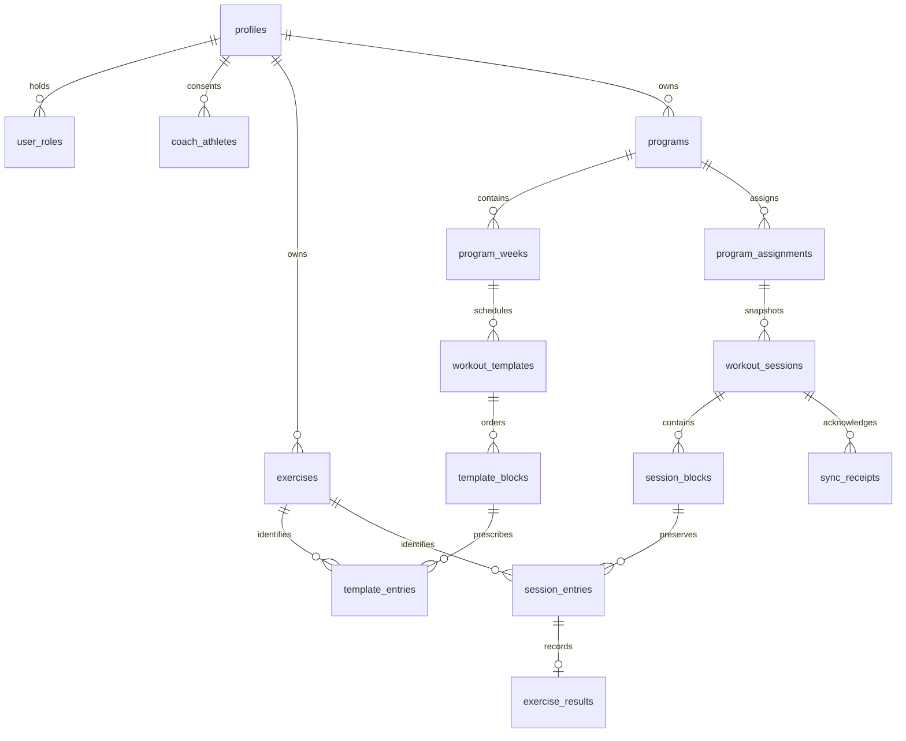

# Architecture and decisions

The three files in `docs/product` are the authoritative product knowledge. Technical choices below fill their unspecified details.

## Application

Next.js App Router, React, strict TypeScript, Tailwind v4 with semantic CSS tokens, Lucide icons, Supabase JS with schema-derived TypeScript types and runtime-validated session responses, TanStack Query for coach reads, and Dexie for durable athlete data. No service-role key, custom production backend, generated sample training, or remote font dependency. The public Next.js shell is intentionally cacheable and contains no personal data. Hash navigation keeps every operational screen on the same offline-capable document. `/api/me` demonstrates server-validated bearer authentication; protected business operations go directly to Supabase with the same user's JWT and are checked there.

Authentication is client-side email/password, including email-confirmation callbacks to the origin. Supabase persists/refreshes tokens. Server-rendered authenticated content/cookie middleware is deliberately unnecessary for this offline shell: local cached identity gates the UI, while actual authority always comes from RLS/RPC checks. A previously authenticated account can access cached workouts on its device without contacting the server. This is a device cache, not proof of current server authorization. A revoked/expired token cannot synchronize. Reauthentication keeps local edits; a different account cannot take over another account's outbox.

No data exists until a coach creates/imports a program and assigns it. Empty states are intentional.

## Relational database

`supabase/migrations/202611060001_prgrs.sql` applies transactionally to a fresh Supabase project. Migration history, rather than rerunning CREATE statements, supplies repeatability. Use a dedicated project; never reset production.

Ownership, exercise identity, assignment, schedule, blocks, entries and results are relational. JSONB is reserved for flexible prescriptions, extensible result metrics, and RPC transport. Import JSON is decomposed transactionally; it is not a blob database.

- Signup trigger creates profile + athlete capability. Coach capability is granted by a trusted administrator in SQL, never from signup metadata.
- Coach-athlete access requires an athlete-accepted relationship. An account can coach itself without a relationship row.
- Program weeks have 1–52 numbered weeks. Day 1 is the assignment start date; day 2 is the next date, rather than an implicit weekday. Duplicate-day workouts are allowed and ordered.
- Workout templates are reusable through program duplication and builder copy controls. Program edits create a new version of the reusable definitions. Assignments record the version used.
- Assignment copies ordered blocks, labels, prescription, exercise display name, instructions, eligibility, and reference URL into session tables. Exercise ID stays stable. Changing templates/library records never updates snapshots or results.
- Deleting/replacing templates nulls the optional source template link; history remains. Workout/session history has restrictive foreign keys and no browser delete grants. Account deletion/anonymization is an explicit future administrative workflow, not a cascading loss of history.
- Stable exercise keys are unique per coach. Imports reuse that coach's existing canonical movement; existing library name/video wins. Keys should be deliberately reused; aliases do not perform fuzzy identity matching. Update the library before assigning if a reference/name needs changing.
- RLS is enabled on every application table. Read access follows ownership and accepted relationships. No browser may write roles, assignments, snapshot structure, results, or receipts directly. Definer RPCs have fixed search paths, explicit caller checks, atomic writes, and restricted execution grants. Client Zod validation is supplemented by server validation.
- Foreign keys, natural uniqueness, UUIDs, status constraints and useful ownership/ordering indexes enforce integrity. Results have one row per session entry. Receipts have one row per logical mutation.

## Workout and metric invariants

`finished` and `finished_at` finalize a session independently of eligible completion. The database requires a finished timestamp exactly when status is finished. Reopening clears the timestamp and retains results. Finished sessions require explicit reopening before UI edits. Instruction blocks cannot include eligible entries; other reference/rest entries can set `eligible:false`. Sessions without eligible entries are rest/instruction sessions and are excluded from adherence.

Completion aggregates **completed eligible entries / eligible entries** in the chosen schedule range, including local pending edits. Never average percentages. Dashboard week/month exercise completion includes that entire scheduled range; overall includes sessions through today. Adherence is **finished due eligible sessions / due eligible sessions**, where due means the athlete-local schedule date is today or earlier. Skipped, missed, and in-progress sessions remain in the due denominator. Future sessions are scheduled, never missed. No denominator is N/A. Finished incomplete sessions display partial completion without changing their status.

Dates are ISO date-only values. Calendar math uses UTC noon to avoid DST shifts; determining today uses the profile's IANA timezone. Results/finalization use UTC timestamps. Same-day multiple sessions are independent. The server log timestamp is the athlete's supplied finish time; receipt timestamps record server acknowledgement.

## Offline persistence and synchronization

IndexedDB stores `sessions`, one cached `identity`, and an `outbox`. Workout writes use one read/write transaction across session and outbox tables. Each mutation receives a client UUID, owner, session, expected base version, complete small result log, timestamp and attempt/error fields. Every local edit increments the local session version. Inputs write on change, including before blur. TanStack Query is not the persistence layer.

Foreground sync runs on open, reconnect, visibility return, a short delay after edits, and every 30 seconds while mounted. Retries retain the original UUID. A single foreground loop runs per account in a tab; duplicate sends from multiple tabs are safe at the database. Session rows are locked during server mutation; an existing receipt returns its original acknowledgement. Expected-version mismatch creates an explicit conflict. Each transaction validates every result belongs to that session and that instruction entries are not marked completed. Results + finalization + version increment + receipt commit together. A lost network acknowledgement can be retried without a second write. The client deletes only acknowledged mutations.

Pending operations are ordered by session and base version. An error blocks later operations for that session while allowing unrelated sessions to sync. Remote reads never overwrite a session with pending local edits or regress a newer version. Online reconciliation removes inaccessible cached sessions when no local edits are pending. A removed relationship cannot immediately erase an offline device's existing cache; reconnect or logout is required.

Conflicts retain the local session, failed mutation and remote version. Profile shows a comparison of results and finalization. The user explicitly chooses to rebase their complete local log onto the current server version or replace local data with the server version. Export is available before either choice. No automatic last-write-wins. A second conflict requires review again. Complete-log conflict resolution deliberately trades granular merging for predictable, reviewable choices.

Logout refuses to silently delete pending work. Synchronize first, or export and explicitly confirm discard. Successful logout atomically refuses any newly queued edits and clears personal IndexedDB and query caches. In-flight remote pulls cannot repopulate the cache after logout. Public shell caches contain no private responses. IndexedDB/auth storage is device-local browser storage, not separately encrypted; use a trusted device and sign out on shared devices. Browser/OS eviction or manually clearing storage can remove unsynced data; export pending logs when needed. The browser requests persistent storage when supported to reduce eviction risk. No application can guarantee persistence after OS storage deletion.

## PWA and presentation

Manifest, PNG/SVG icons, Apple metadata, viewport safe areas and standalone display are supplied. The production service worker precaches the public document and its initial Next scripts/styles, then caches same-origin static assets. Supabase/auth/API/RSC responses are never service-worker cached. Navigation falls back to the public document; Dexie restores the actual view. New service workers wait for old clients to close, avoiding a forced reload during a workout. Bump the shell cache version when changing shell strategy. External videos require connectivity. Development deliberately does not install a service worker.

Light/dark colors use shared tokens; system preference is the default and explicit selection persists locally. Touch targets, native labels, keyboard focus, semantic checkbox buttons, dialog focus trapping, reduced-motion rules and responsive navigation support gym use.

## Deliberate limits

No production credentials/accounts/deployment were used. SQL runs in real embedded PostgreSQL for tests with an `auth.uid()` shim; browser Auth endpoints are test-only simulations. Hosted Supabase, real confirmation mail, real iOS installation/force-close/storage eviction, and Vercel deployment still need the setup/device checklist. Coach editing is online; offline support prioritizes synchronized athlete workouts. Detailed sets, timers, nutrition, chat, payments and in-app AI generation remain outside MVP.
